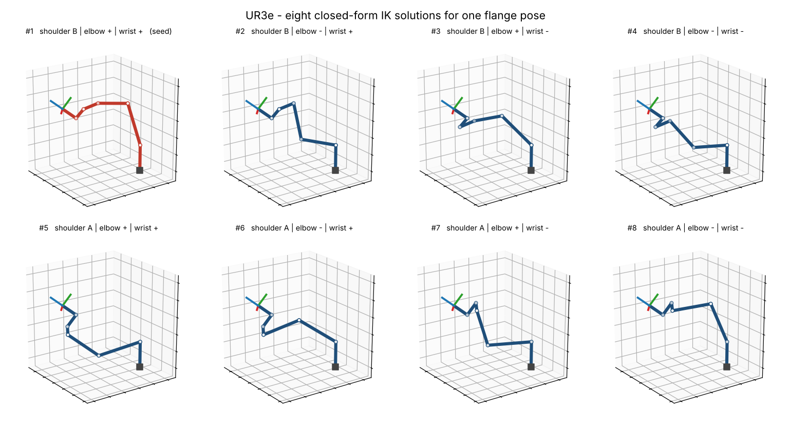
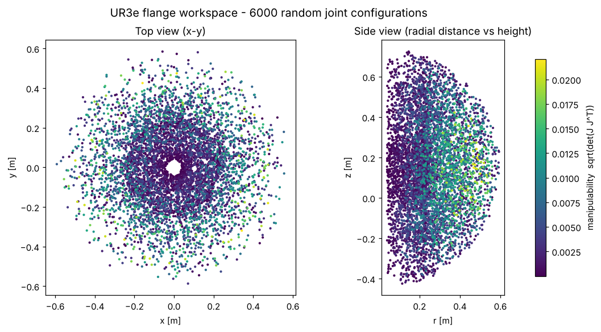

# ur-kinematics

**Fast, tested Python kinematics for Universal Robots e-Series arms (UR3e, UR5e, UR10e).**
Forward kinematics, all 8 closed-form inverse-kinematics solutions, a geometric Jacobian,
manipulability, and a damped least-squares IK solver, with NumPy as the only dependency.

[](https://github.com/Mohammedgmail/ur-kinematics/actions/workflows/ci.yml)




## Why

When training manipulation policies in simulation and transferring them to a real UR3e
(the arm used in my MSc dissertation on sim-to-real reinforcement learning), I kept needing
the same few things: check a target pose is reachable, pick the IK branch that does not flip
the wrist, and know how close the arm is to a singularity. This package does exactly that,
in a few hundred lines that are easy to read and verify.

## Features

| | |
|---|---|
| **Forward kinematics** | Flange or tool (TCP) pose from 6 joint angles; all intermediate frames for plotting |
| **Analytical IK** | Every solution (up to 8) in closed form, unreachable poses return an empty array |
| **Closest-solution IK** | Chooses the branch nearest the current joint state, using 2π-equivalent angles within joint limits |
| **Numerical IK** | Levenberg-Marquardt damped least squares with adaptive damping; works with any tool offset |
| **Jacobian** | 6×6 geometric Jacobian in the base frame (flange or TCP) |
| **Manipulability** | Yoshikawa index for singularity checking |
| **UR pose format** | Convert between 4×4 transforms and `[x, y, z, rx, ry, rz]` rotation vectors |

## Install

```bash
pip install git+https://github.com/Mohammedgmail/ur-kinematics.git
# or, to run the examples and tests
git clone https://github.com/Mohammedgmail/ur-kinematics.git
cd ur-kinematics
pip install -e ".[dev]"
```

## Quick start

```python
import numpy as np
from urkin import UR3e, pose_to_rotvec

robot = UR3e()
q_now = np.array([0.3, -1.2, 1.4, -0.9, 1.1, 0.4])  # radians

T = robot.fk(q_now)  # 4x4 flange pose in the base frame
print(pose_to_rotvec(T))  # [x, y, z, rx, ry, rz]

solutions = robot.ik(T)  # shape (8, 6): every way to reach T
best = robot.ik_closest(T, q_ref=q_now)  # the one that moves the least

print(robot.manipulability(q_now))  # -> 0 near a singularity

tool = np.eye(4)
tool[2, 3] = 0.12  # 12 cm TCP offset
result = robot.ik_numerical(robot.fk(q_now, tool), q0=np.zeros(6), tool=tool)
print(result.success, result.q)
```

More in [`examples/`](examples): `quickstart.py`, `plot_ik_solutions.py`, `plot_workspace.py`.

## How it works

**Model.** Standard Denavit-Hartenberg parameters published by Universal Robots.
For the UR3e:

| Joint | a [m] | d [m] | α [rad] |
|:-:|--:|--:|--:|
| 1 | 0 | 0.15185 | π/2 |
| 2 | −0.24355 | 0 | 0 |
| 3 | −0.2132 | 0 | 0 |
| 4 | 0 | 0.13105 | π/2 |
| 5 | 0 | 0.08535 | −π/2 |
| 6 | 0 | 0.0921 | 0 |

**Inverse kinematics.** The UR geometry (three parallel middle axes) admits a closed-form
solution with three binary choices, giving up to 2 × 2 × 2 = 8 solutions:

1. **q1** from the wrist-centre position (shoulder branch A or B).
2. **q5** from the flange position projected on the shoulder plane (wrist + or −).
3. **q6** from the flange orientation (undefined at the wrist singularity q5 = 0, set to 0).
4. **q2, q3** from a planar two-link problem (elbow + or −).
5. **q4** from the remaining rotation.

**Numerical IK** minimises the 6-D pose error `[Δp, log(R_target R^T)]` with
`Δq = Jᵀ (J Jᵀ + λ² I)⁻¹ e`, shrinking λ after accepted steps and growing it after rejected ones.



## Validation

The test suite (`pytest`) runs on every push via GitHub Actions, for all three models:

- Every analytical IK solution reproduces the target pose to 1e-8, over 200 random configurations per model.
- The original joint vector is always among the returned solutions.
- The geometric Jacobian matches finite differences of the forward kinematics.
- Numerical IK started from 300 random seeds converges only to the 8 analytical solutions.
- Manipulability is zero at the wrist (q5 = 0) and elbow (q3 = 0) singularities.
- Rotation-vector conversions are stable near 0 and π.

## A note on frames

Poses are expressed in the **DH base frame** used by UR's published parameters, with the
flange frame at the end. The base frame shown on a teach pendant can differ from this
(commonly by a rotation about z), so check conventions on your own setup before sending
targets to a real robot.

## Project layout

```
src/urkin/
  kinematics.py   # URRobot: fk, ik, ik_closest, ik_numerical, jacobian, manipulability
  robots.py       # DH tables for UR3e / UR5e / UR10e
  transforms.py   # SO(3)/SE(3) helpers, rotation vectors, pose error
  plotting.py     # optional Matplotlib stick-figure drawing
tests/            # pytest suite
examples/         # runnable scripts that produce the figures above
```

## Roadmap

- [ ] Benchmark script (IK calls per second)
- [ ] Parameters for UR15, UR20 and UR30
- [ ] Joint-limit and self-collision filtering of IK solutions
- [ ] Cross-check against the official URDF in PyBullet
- [ ] ROS 2 service wrapper
- [ ] Publish to PyPI

## References

- Universal Robots, *DH parameters for calculations of kinematics and dynamics*.
- K. P. Hawkins, *Analytic Inverse Kinematics for the Universal Robots UR-5/UR-10 Arms*, Georgia Institute of Technology, 2013.
- T. Yoshikawa, "Manipulability of Robotic Mechanisms", *International Journal of Robotics Research*, 1985.

## Author

**Mohammed Alfandi** · MSc Robotics & AI, Newcastle University ·
[LinkedIn](https://linkedin.com/in/mohammed-alfandi/) · [ResearchGate](https://researchgate.net/profile/Mohammed-Alfandi/)

Released under the [MIT License](LICENSE).
